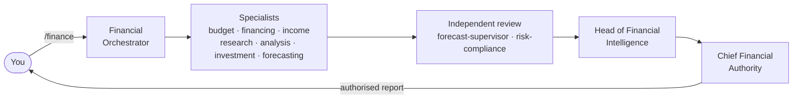

# Financial Intelligence Agents

**An on-demand, 12-agent financial research team for Claude Code.** It plans budgets, compares loans, evaluates online-income ideas, researches markets, values companies and builds forecasts. Every conclusion passes independent verification before you see it.

> Research and education only. Not licensed financial, tax or legal advice. The agents never execute trades, transfers or applications. You keep every decision.

---

## What it does

| Area | Examples |
|---|---|
| Budgeting and planning | Monthly budgets from your numbers, emergency-fund plans, savings goals, opportunity costs |
| Financing and debt | Loan and mortgage comparisons on **total cost** (fees included), avalanche vs snowball, refinancing break-even, predatory-lending checks |
| Online income | Legitimate opportunities scored on 11 criteria, scam screening, 30/60/90-day roadmaps |
| Market research | Multi-pass, source-tiered research on macro conditions, companies, filings and events |
| Stock and investment analysis | Ratios vs peers and history, technicals with caveats, DCF / reverse DCF / comps, bull-base-bear theses |
| Forecasting | Benchmark-anchored scenarios with an independent adversarial supervisor and an immutable forecast journal |
| Risk and compliance | Concentration, leverage, liquidity, fraud signals, stress tests, suitability, with blocking authority |

## How it works



- **Selective:** only the agents a request needs are activated. A simple budget uses 2 agents, not 12.
- **Verified:** claims carry evidence labels and source tiers; the Head re-checks claims and recalculates; the Chief authorises the *report* (never a transaction).
- **Deterministic maths:** every number comes from `tools/fincalc.py` (standard-library Python with known-answer tests).
- **Manual only:** nothing runs until you type `/finance`. A hook *technically* blocks finance agents outside an open session.

## The team

| # | Agent | Role |
|---|---|---|
| 01 | `financial-orchestrator` | Coordinates: picks agents, writes briefs, routes verification, delivers |
| 02 | `budget-analyst` | Budgets, savings, projections |
| 03 | `financing-advisor` | Loans, credit, debt strategy |
| 04 | `income-strategist` | Online income and business evaluation |
| 05 | `market-researcher` | Multi-pass, source-verified research |
| 06 | `market-analyst` | Fundamental and technical analysis |
| 07 | `investment-researcher` | Due diligence and valuation |
| 08 | `market-forecaster` | Scenario forecasting |
| 09 | `forecast-supervisor` | Adversarial forecast review |
| 10 | `risk-compliance-analyst` | Risk, fraud, suitability (can block) |
| 11 | `head-financial-intelligence` | Verification and consolidation |
| 12 | `chief-financial-authority` | Final report authorisation |

Details: [docs/AGENT_ROLES.md](docs/AGENT_ROLES.md)

## Install

```bash
git clone https://github.com/aliakbarbhojani/financial-intelligence-agents.git
cd financial-intelligence-agents
python3 tests/run_all.py     # automated tests
claude                       # accept the trust dialog once so hooks can run
```
Requirements: Claude Code with subagents, skills and hooks (validated on 2.1.331), Python ≥ 3.9. No paid APIs, no third-party Python packages. To add the team to an existing project, see [docs/USAGE.md](docs/USAGE.md#install).

## Use

```text
/finance <request>                    standard mode (default)
/finance quick <request>              fastest, lightest
/finance deep <request>               full research + adversarial review (more usage)
/finance agent <name> <request>       one specialist, unreviewed
/finance status | stop | help
```

```text
/finance quick Net income 3,800/month; rent 1,450, groceries 420, transit 130, dining 280. How fast can I build a 3-month emergency fund?
/finance Compare a 20,000 loan at 8.4% for 4 years with a 250 fee vs 7.6% for 6 years with no fee.
/finance deep Full due diligence on <TICKER>: valuation, moat, risks, bull/base/bear.
```

You can also run `claude --agent financial-orchestrator` for a dedicated finance session. More examples: [docs/USAGE.md](docs/USAGE.md).

## Operational modes

| | Quick | Standard | Deep |
|---|---|---|---|
| Agents | 1–2 + Chief | relevant only | research + analysis + supervisors |
| Web searches | 0–3 | ≤ 20 | ≤ 60 |
| Review | consolidated | Head → Chief | full hierarchy |
| Starts | on request | default | only with your explicit OK |

## Research and verification standards
Three source tiers (primary → reputable secondary → sentiment-only), 2–3 research passes, syndicated copies counted once, a data-integrity record for every market figure (as-of date, exchange, currency, live/delayed), evidence labels on every claim, contradictions disclosed rather than outvoted, and at most 2 revision cycles. See [the shared standards](.claude/skills/finance-standards/SKILL.md) and [docs/WORKFLOWS.md](docs/WORKFLOWS.md).

## Security and privacy
Manual-only activation, least-privilege tools, agents restricted to the calculator for shell access, no writes to their own instructions, an append-only forecast journal and error log, URL blocking, secrets unreadable, and no transaction-capable tools. Each control is marked as **technically enforced** or **prompt-based** in [docs/SECURITY.md](docs/SECURITY.md). Personal data is stored only with your consent, in git-ignored `memory/private/`.

## Memory
A controlled, file-based knowledge base in [`memory/`](memory/README.md): verified methodologies, source preferences, user-approved lessons, an analytical error log, a timestamped forecast journal (never retro-edited), and a research cache with revalidation dates. It improves instructions and retrievable knowledge. No model is retrained.

## Testing

```bash
python3 tests/run_all.py                    # unit + guardrail + static (no model usage)
bash tests/runtime/run_runtime_smoke.sh     # live smoke tests (uses some usage)
```
Results and honest status of every test: [tests/TEST_REPORT.md](tests/TEST_REPORT.md).

## Known limitations
- Hook-based guardrails need a trusted workspace and an organisation policy that allows user hooks. Without them, those controls fall back to prompt-level behaviour.
- Live market data depends on WebSearch/WebFetch or an optional MCP data server. Prices may be delayed, and reports state this.
- Full multi-agent workflows have been validated statically and through Claude Code's agent loader. The live end-to-end scenarios in `tests/runtime/` must be run in your own authenticated environment.
- Not a substitute for a licensed professional.

## Optional integrations
Read-only market-data MCP servers can be added (see [`config/mcp.example.json`](config/mcp.example.json)). Keep keys in environment variables, grant servers only to research agents, and review cost and permissions first.

## Contributing
1. Fork, branch, and keep changes focused.
2. Run `python3 tests/run_all.py`. All suites must pass, and new calculator functions need known-answer tests.
3. Never commit anything from `memory/` (except README/knowledge), `reports/`, `.claude/state/` or credentials.
4. Describe behavioural changes to agents in `CHANGELOG.md`. Changes that weaken guardrails will not be accepted.

## License
[MIT](LICENSE)
