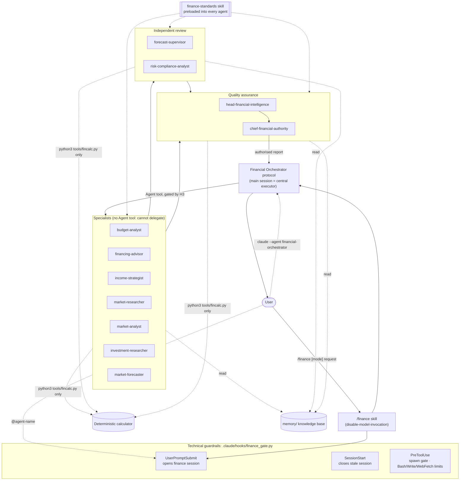

# Architecture

## Design goals
Accuracy and verifiability first, then safety, then resource efficiency. Every conclusion passes an independent review chain, every number comes from a deterministic calculator, and the whole system sleeps until the user explicitly wakes it.

## Component overview



## Key decisions

| Decision | Rationale |
|---|---|
| **Main session acts as orchestrator** (via `/finance`) | Nested subagent delegation is configurable (`CLAUDE_CODE_MAX_SUBAGENT_SPAWN_DEPTH`) and may be off; the build environment had it off. A central executor works everywhere, keeps user interaction (clarifying questions, deep-mode consent) native, and avoids an extra context layer. |
| `claude --agent financial-orchestrator` as alternative | For dedicated finance sessions. In this mode Claude Code **enforces** the orchestrator's `Agent(...)` allowlist. |
| Specialists have `Agent` in `disallowedTools` | Prevents uncontrolled fan-out; all delegation is visible in one place. |
| Shared rules in a preloaded skill (`finance-standards`) | One source of truth for evidence labels, source tiers, data integrity, safety and handoff format. Injected at agent start (no extra tool calls). |
| `omitClaudeMd: true` on specialists | Specialists don't need repo-development instructions; saves context. Ignored harmlessly on older versions. |
| Deterministic calculator | LLM arithmetic is unreliable. `tools/fincalc.py` is standard-library Python with known-answer tests. |
| File-based memory instead of agent `memory:` field | The built-in field depends on auto memory being enabled and lets agents freely rewrite their own memory. A controlled `memory/` tree with hook-enforced write paths is deterministic and auditable. |
| Hook-enforced, not just prompted, boundaries | Descriptions can't stop auto-delegation, and `tools:` can't restrict Bash patterns. A PreToolUse hook can, and it receives `agent_type` for calls made inside subagents. |

## Context and token flow
- Delegation briefs are ≤ 300 words plus prior handoff blocks. The conversation is never forwarded.
- Handoffs are compact structured summaries with source tables, not raw page dumps.
- Quick mode consolidates Head + Chief review into a single Chief pass.
- Verified, non-personal research is cached in `memory/research-cache/` with `revalidate_by` dates.
- `maxTurns` bounds every specialist (20–45). Revision cycles are capped at 2.
- No token counts are claimed unless measured (e.g. `claude -p --output-format json` reports `usage`).

## Model allocation

| Model | Agents | Why |
|---|---|---|
| `opus` | investment-researcher, forecast-supervisor, head-financial-intelligence | Deepest reasoning: valuation, adversarial review, consolidation |
| `sonnet` | budget, financing, income, market-researcher, market-analyst, market-forecaster, risk-compliance, chief | Strong, cost-efficient analysis; calculations are offloaded to `fincalc` |
| `inherit` | financial-orchestrator | Uses the session's model |
| `haiku` (override) | Orchestrator may pass `model: haiku` for simple Quick-mode calculation tasks | Cheapest adequate tier |

Change any agent's `model:` line to match your plan and budget.

## Directory map
```text
.claude/agents/          12 agent definitions (YAML frontmatter + system prompt)
.claude/skills/finance/  /finance entry point (manual-only)
.claude/skills/finance-standards/  shared standards, preloaded into agents
.claude/hooks/finance_gate.py      guardrail hook (stdlib Python)
.claude/settings.json    permissions + hook registration
config/                  modes, blocked domains, optional MCP example
memory/                  controlled knowledge base (mostly git-ignored)
templates/               report, handoff, journal, error-log, cache, test-record templates
tools/fincalc.py         deterministic financial calculator
tests/                   unit, guardrail, static and runtime test plans
```
