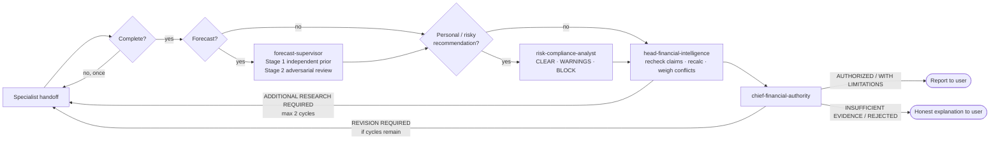
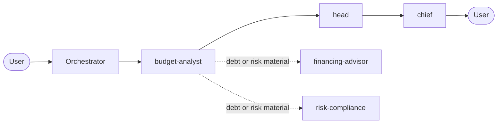
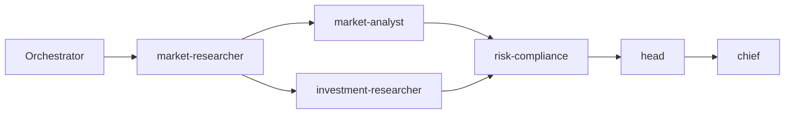

# Workflows

All workflows start with an explicit `/finance` command and end by closing the finance session. Arrows are sequential unless marked parallel.

## Verification hierarchy (all workflows)

## A: Personal budgeting

Quick mode: `budget-analyst → chief (consolidated review)`.

## B: Financing and debt
`Orchestrator → financing-advisor → risk-compliance-analyst → head → chief`

## C: Online income and business
`Orchestrator → income-strategist → (market-researcher and/or risk-compliance-analyst if needed) → head → chief`

## D: Comprehensive investment research

`market-analyst` and `investment-researcher` may run in parallel because both depend only on the researcher's handoff. Forecasting agents join only if forward-looking analysis was requested.

## E: Market predictions and forecasting
`Orchestrator → market-researcher → market-analyst → market-forecaster → forecast-supervisor → risk-compliance-analyst → head → chief`

Supervisor independence: the orchestrator sends research and analysis first (Stage 1), then continues the same supervisor with the forecast (Stage 2). If continuing an agent isn't available, the forecast is placed in an "open after Stage 1" appendix.

## Educational / definitional questions
`Orchestrator drafts → chief (consolidated review)`. No specialists, no web research unless facts need current verification.

## Modes

| | Quick | Standard (default) | Deep (opt-in only) |
|---|---|---|---|
| Specialists | 1–2 | relevant only | relevant research + analysis |
| Review | Chief (consolidated) | Head → Chief | Supervisors + Risk + Head → Chief |
| Web searches (total) | 0–3 | ≤ 20 | ≤ 60 |
| Research passes | 0–1 | 2 | 2 + targeted 3rd |
| Revision cycles | 1 | ≤ 2 | ≤ 2 (more only with consent) |

Override: `/finance quick …`, `/finance deep …`. The orchestrator may *propose* deep mode but never starts it without a "yes".

## Single-agent mode
`/finance agent <name> <request>` or `@agent-<name> …` runs one specialist directly. Its output is labelled **UNREVIEWED** because it skips the Head and Chief.

## Failure handling
- Agent failure or turn limit: one narrower retry, then continue without it and disclose the gap.
- No web or data access: limitation stated, claims narrowed, nothing simulated.
- Usage limits: deliver verified work marked `INCOMPLETE`, with remaining steps listed.
